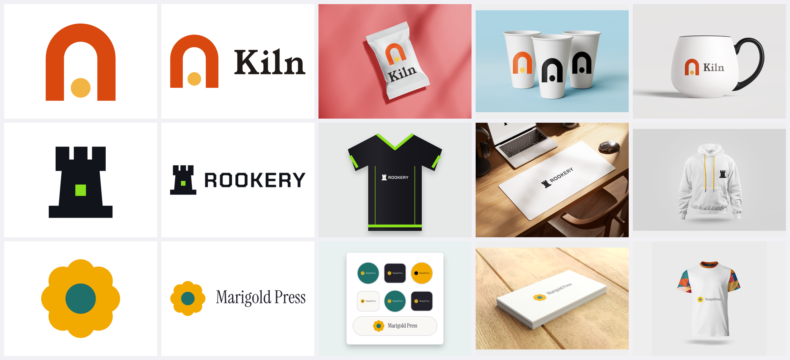

# brand-studio

[](https://github.com/shadowtor/BrandDesign/actions/workflows/test.yml) [](LICENSE)

**A brand identity and logo design skill for AI coding agents** (Claude Code, Codex CLI, Gemini CLI and anything that reads
Agent Skills folders: a directory with a `SKILL.md`). Give it a business brief; it researches the category, shows **three greyscale
logo sketches** for you to choose from, has an **independent sub-agent review them**, and only then builds the full brand kit.



<sub>Kiln (coffee roastery), Rookery (gaming community) and Marigold Press (illustrator): fictional briefs, every file in
[`examples/`](examples) was produced by the skill. Merch is chosen for each business, not a generic mug and shirt.</sub>

**Website:** [shadowtor.github.io/BrandDesign](https://shadowtor.github.io/BrandDesign/)

**Contents:** [What you get](#what-you-get) · [Install](#install) · [Use](#use) · [Merch by business type](#merch-is-chosen-for-the-business) ·
[Examples](#examples) · [Limits](#what-it-will-not-do-for-you) · [Develop](#develop) · [Credits](#credits-and-attribution)

## What you get

| | |
|---|---|
| **Logos** | square, horizontal, vertical, symbol, wordmark × colour (light), colour (dark), black, white, greyscale × **SVG / PNG / JPG / PDF** |
| **Favicons** | favicon.svg/.ico, 16–48 px, apple-touch, 192/512, maskable, web manifest, head snippet, plus a **test sheet and report** (ICO structure, sizes, manifest, safe zone, 16 px legibility on light and dark tabs) |
| **Social** | avatars (3 backgrounds × 3 sizes) and banners for LinkedIn, X, Facebook, YouTube, link previews, Instagram |
| **Stationery** | A4 letterhead (sample + blank), header and footer strips, business card print file with bleed, email signature |
| **Merch mockups** | items chosen for the business type (a coffee bean bag and travel mug for a roaster; jersey, mouse mat and hoodie for a gaming community; USB stick, cables and lanyards for tech…), **photographic** via free PSD mockups (opt-in) or labelled illustrations |
| **Guidelines** | a PDF built from the real files: idea, logo family, clear space, versions, colour (HEX/RGB/HSL/OKLCH, contrast), type, misuse (including ones only this mark can suffer), favicon test, social, stationery, merch |
| **Tokens** | CSS, SCSS, Tailwind, DTCG JSON, GIMP palette, swatches; font embed notes |

**How it works:** intake → category research (bundled 1,400-logo and brand-palette libraries + live Fontsource/colour APIs) →
8–12 one-line concepts → **three different sketches** (black SVG, audited at 16 px, one colour, reversed) → independent review →
**you pick** → refine, colour (WCAG-audited), type (real outlined fonts), lockups → `build_kit.py` → kit review → handover with the
open items stated plainly (trademark search, print proofing, real-browser favicon check).

## Install

You need Python 3.9+, a Chromium-based browser (Chrome, Edge, Brave, Chromium) and internet access for fonts. [`uv`](https://docs.astral.sh/uv/)
is recommended (it installs Pillow, pypdf, fonttools, uharfbuzz and psd-tools on first use).

### A. Claude Code plugin marketplace

```text
/plugin marketplace add shadowtor/BrandDesign
/plugin install brand-studio@brand-studio
```

### B. Installer script (Claude Code, Codex CLI, Gemini CLI, any agent)

```bash
git clone https://github.com/shadowtor/BrandDesign.git
cd BrandDesign
python tools/install.py --claude --codex          # or --gemini, --project, --dest <folder>, --link (symlink for development)
python skills/brand-studio/scripts/check_setup.py # verifies Python, uv, browser, network
```

Manual alternative: copy the `skills/brand-studio` folder to `~/.claude/skills/brand-studio` (Claude Code), `~/.codex/skills/brand-studio`
(Codex), `~/.gemini/skills/brand-studio` (Gemini) or your agent's skills folder. Start a **new session** afterwards.

### C. Let your AI agent install it (copy-paste)

Paste this into your agent. It follows [`docs/INSTALL-FOR-AGENTS.md`](docs/INSTALL-FOR-AGENTS.md), which it can also read from the repo.

```text
Install the "brand-studio" Agent Skill for me.

1. Clone https://github.com/shadowtor/BrandDesign (or git pull if I already have it) and read
   docs/INSTALL-FOR-AGENTS.md in it. Follow that file exactly.
2. Install it for the agent I am using right now (python tools/install.py --claude, --codex or --gemini; use --dest for others).
   Only copy the skills/brand-studio folder; do not change anything inside it and do not run any other script from it.
3. Run: python skills/brand-studio/scripts/check_setup.py. If it reports a FAIL, show me the line and its fix and stop. If it reports
   WARN lines (for example uv missing), explain what is limited and offer the fix.
4. Tell me where it was installed, the check result, and that I must start a new session. Do not commit, push or download anything
   else. Then give me one example request I can try.
```

### D. Upload as a skill file

`python tools/package_skill.py` writes `dist/brand-studio.zip` (and a `-lite` zip without the reference SVGs) for UIs that take a skill upload.
Note: the skill runs scripts and a browser; use an environment that allows both (a code-capable agent, not plain chat).

## Use

Just ask:

> Design a brand identity for **Rookery**, a competitive-but-welcoming gaming community. Three logo sketches first.

> Here is our logo (logo.svg): what is wrong with it, and how would you refresh it without losing recognition?

> Turn this symbol into a favicon set and social avatars, and test the favicon at 16 px.

It asks a few questions (or states assumptions), shows the concept sheet and **stops**. Pick a direction and say go; it builds the kit
into the folder you name (on Windows keep the work folder on a short path).

Build a kit by hand from approved artwork:

```bash
cp skills/brand-studio/templates/brand.example.json brand.json   # edit names, colours, logo file paths, business_type
python skills/brand-studio/scripts/build_kit.py brand.json --out deliver                    # everything except photo mockups
python skills/brand-studio/scripts/build_kit.py brand.json --out deliver --photo-mockups    # + photographic merch previews
```

Photographic merch previews are opt-in: the first run downloads free PSDs from mockups-design.com into `~/.cache/brand-studio`
(roughly 5 minutes; see [credits](#credits-and-attribution)).

## Merch is chosen for the business

`scripts/merch_catalog.py` maps a `business_type` to the items that kind of business really makes (override with an explicit list).

| Business | Items |
|---|---|
| Coffee | bean bag, travel mug, takeaway cup, mug, apron, tote, tee, cap |
| Gaming / esports | team jersey, mouse mat, hoodie, tee, cap, sticker sheet, lanyard, keyring |
| Tech / SaaS | business card, USB stick, charging cable, lanyard, phone case, laptop sleeve, tee, sticker sheet |
| Artist / illustrator | sticker sheet, business card, tee, tote, notebook, poster, pin badge |
| + fashion, fitness, finance, services, health, beauty, events, music, education, community, retail, trades, kids, pets, bakery, bar | see [`merch-catalogue.md`](skills/brand-studio/references/merch-catalogue.md) |

Each item uses a photographic mockup when a free PSD exists, otherwise a drawn illustration, and every file is labelled
*photographic mockup* or *illustration* in the guidelines. Nothing is shown that was not actually made.

## Examples

Fictional brands, built end to end. Each folder has the `brand.json`, the final SVG artwork, every SVG logo version, and previews of
the guidelines PDF, favicon test, social banner, letterhead and merch mockups.

| Example | Business | Mark | Merch set |
|---|---|---|---|
| [Kiln](examples/kiln) | specialty coffee roastery | arched kiln mouth with an ember | bean bag, takeaway cup, mug, travel mug, apron, tote |
| [Rookery](examples/rookery) | competitive gaming community | pixel-block rook with one lit window | jersey, mouse mat, hoodie, tee, cap, sticker sheet |
| [Marigold Press](examples/marigold) | independent illustrator | eight-petal marigold seen from above | sticker sheet, business card, tee, tote, notebook, poster |

## What it will not do for you

- **No trademark clearance.** Search before launch (IP Australia, WIPO Global Brand Database, EUIPO TMview, USPTO). The skill says so every time.
- **CMYK is indicative, Pantone is blank.** Print needs the printer's profile and a proof.
- **The favicon test is a simulated tab.** Open the live site in a real browser once.
- **Mockups are previews**, not publishable artwork; third-party PSDs are never redistributed.
- It cannot guarantee a mark is unique. The reference libraries are for study; never copy or trace them.

## Develop

```bash
python tools/smoke_test.py        # runs the scripts end to end (needs a Chromium browser + internet)
python tools/package_skill.py     # dist/brand-studio.zip
python tools/install.py --link    # symlink the skill into your agent folders and edit in place
```

Layout: [`docs/architecture.md`](docs/architecture.md). Contributions welcome: see [`CONTRIBUTING.md`](CONTRIBUTING.md) (new merch items,
business types, sector reference data, evals).

## Licence

MIT, see [LICENSE](LICENSE). Incorporates MIT work (see credits). The reference logo and palette libraries, fonts and mockup PSDs are
third-party material with their own terms: [THIRD_PARTY_NOTICES.md](THIRD_PARTY_NOTICES.md).

---

## Credits and attribution

### Built on
- **[kaankiziltug/logo-design-skill](https://github.com/kaankiziltug/logo-design-skill)** (MIT): the design process, principles, SVG
  construction and testing tooling, concept sheet, 1,400-logo reference library and its example boards.
- **[fatihaydost/brand-identity-skill](https://github.com/fatihaydost/brand-identity-skill)** (MIT): the one-mechanism idea, AI-defaults
  reflex test, OKLCH palette build and WCAG/colour-blindness audit, honest print guidance, kit and critique structure, token export.

### Mockup sources (used for previews only)

The photographic previews in `examples/` were made with free PSD mockups from **[mockups-design.com](https://mockups-design.com/)**
(licence: free for any purpose including commercial use, no attribution required, but the PSD files themselves may not be
redistributed; flattened finished images may be shared: [licence](https://mockups-design.com/license/)). We credit them anyway. The PSDs
are **not** in this repository: the skill downloads them on demand into `~/.cache/brand-studio/mockups` when you run `--photo-mockups`.

| Mockup | Pack | Used in |
|---|---|---|
| [Coffee cup](https://mockups-design.com/paper-coffee-cup-mockup/) | MD049 Free Coffee Paper Cup Mockup | Kiln |
| [Food pouch (coffee bean bag stand-in)](https://mockups-design.com/free-food-pouch-mockup/) | MD474 Free Food Bag Mockup | Kiln |
| [Oval mug](https://mockups-design.com/round-bellied-mug-mockup/) | MD1258 Oval Mug Mockup | Kiln |
| [Apron](https://mockups-design.com/stitched-bib-apron-mockup/) | MD1260 Apron Mockup | Kiln |
| [Hanging tote bag](https://mockups-design.com/hanging-tote-bag-mockup/) | MDP071 Hanging Tote Bag Mockup | Kiln, Marigold Press |
| [Large mouse pad](https://mockups-design.com/oversized-mouse-pad-mockup/) | MD1237 Large Mousepad Mockup | Rookery |
| [Hoodie](https://mockups-design.com/free-hoodie-mockup/) | MDP059 Hoodie Mockup | Rookery |
| [T-shirt](https://mockups-design.com/mens-t-shirt-mockup/) | MD815 T-Shirt Mockup | Rookery, Marigold Press |
| [Baseball cap](https://mockups-design.com/free-baseball-cap-mockup/) | MD341 Free Baseball Cap Mockup | Rookery |
| [Business card](https://mockups-design.com/free-business-card-mockup/) | MD050 Business Card Mockup | Marigold Press |
| [Spiral notebook](https://mockups-design.com/free-spiral-notebook-mockup/) | MD095 Spiral Notebook Mockup | Marigold Press |
| [Poster in frame](https://mockups-design.com/free-posters-mockup/) | MD078 Free Poster Mockup | Marigold Press |

Merch items with no free PSD on that site (jersey, lanyard, phone case, cable, travel mug, sticker sheet…) are drawn by the skill and
labelled **illustration** in every kit. **[Unblast](https://unblast.com/mockups/)** has many more (lanyards, jerseys, phone cases,
USB cards, tumblers, coffee packaging): its mockups come from third-party authors with their own licences and a JavaScript
download step, so the skill does not download them automatically; download one yourself, read its licence, and pass it with
`psd_mockup.py --psd`. Thank you to both sites and to the mockup authors.

### Inspiration and reference sites
[Brand New](https://www.underconsideration.com/brandnew/) · [Fonts In Use](https://fontsinuse.com/) ·
[Branding Style Guides](https://brandingstyleguides.com/) · [Standards Manual](https://standardsmanual.com/) (NASA 1976, NYCTA 1970) ·
[Google Fonts Knowledge](https://fonts.google.com/knowledge) · [Are.na](https://www.are.na/) · guideline anatomy from NASA, NYCTA, Mozilla,
GitLab, Spotify, Uber Eats, Atlassian and Mailchimp (links in `skills/brand-studio/references/bi-kit.md`).

### Services queried at run time
[Google Fonts](https://fonts.google.com/) and the [Fontsource API](https://fontsource.org/docs/api) (fonts, licences),
[TheColorAPI](https://www.thecolorapi.com/) and [Colormind](http://colormind.io/) (palette suggestions), [Iconify](https://iconify.design/)
(symbol inspiration only). Fonts in the examples are SIL OFL families: Young Serif, Hanken Grotesk, Chakra Petch, Barlow, Instrument Serif,
Instrument Sans.

### Research behind the guidance
Colour, type and logo guidance cites its sources inline in the `bi-*` reference cards (WCAG 2.2, Labrecque et al., Phillips et al.,
Henderson & Cote and others, each tagged strong / limited / practice).
