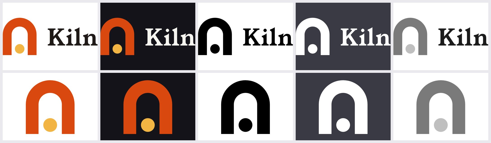
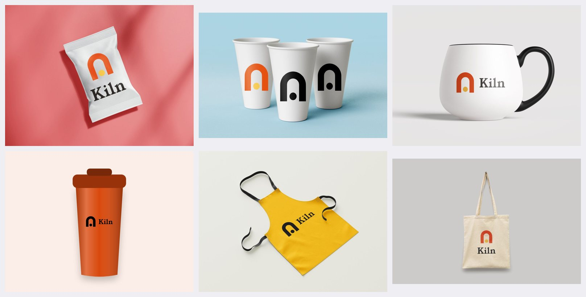
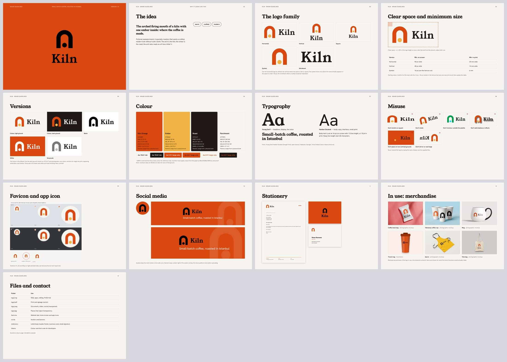
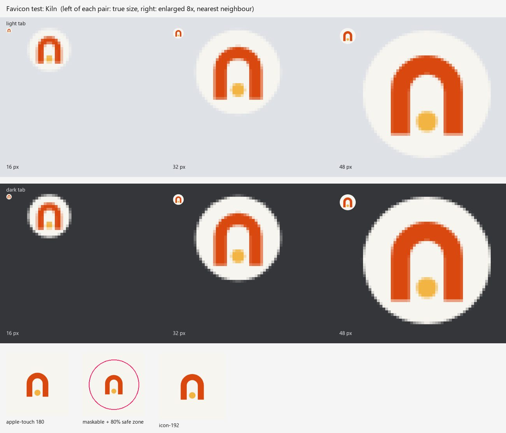
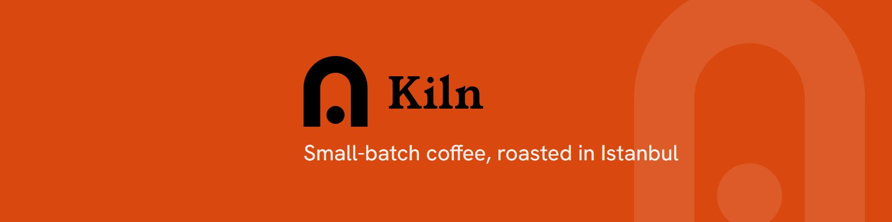
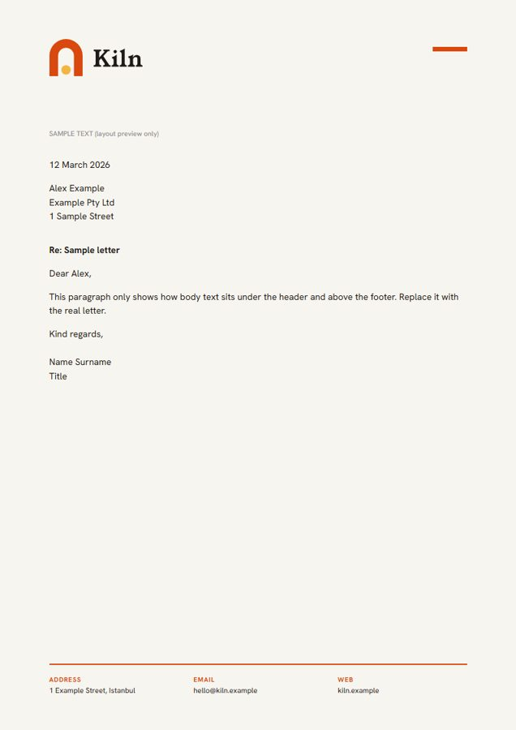

# Kiln

*Specialty coffee roastery, Istanbul (fictional). Not a real business: made to show what the skill produces.*

- Business type: **coffee** (decides the merch set)
- Merch: Coffee bean bag (photo), Takeaway coffee cup (photo), Mug (photo), Travel mug (illustration), Apron (photo), Tote bag (photo)
- Brand data: [`brand.json`](brand.json) · final artwork: [`final/`](final) · all SVG logo versions: [`logo/svg/`](logo/svg)
- Guidelines PDF: [`preview/kiln-brand-guidelines.pdf`](preview/kiln-brand-guidelines.pdf)

## Logo versions (horizontal and symbol × colour-light, colour-dark, black, white, greyscale)

## Merch chosen for this business

## Guidelines pages

## Favicon test

## Social banner and letterhead

Photographic mockups are previews built from free PSDs by mockups-design.com (see the main README credits). The PSDs are not included.
